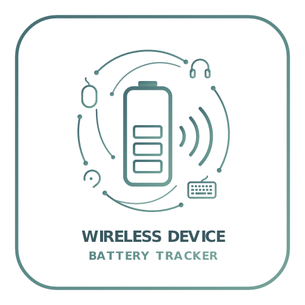

<p align="center">
  
</p>

<h1 align="center">Wireless device battery tracker</h1>

<p align="center">Battery levels of your wireless mice, keyboards, headphones and controllers — right in the Windows 11 taskbar.</p>

---

Each device appears as one small item in the taskbar, next to the language, network and volume
indicators: **device symbol + percentage**, in Windows' own icons and fonts. Click it for a flyout with
every device's level; get a Windows notification when a battery runs low.

## Features

- **Lives in the taskbar.** One item per device, sized to fit, with hover and click like the built-in
  indicators. Moves with the taskbar, including auto-hide. Prefer classic tray icons? Switch in Settings.
- **Colour at a glance.** Amber, then red, as a battery gets low; a green bolt while charging; grey
  when disconnected (keeps the last known level).
- **Notifications.** Low battery (threshold per device), critical battery, fully charged, and
  connected/disconnected alerts.
- **Picks up new devices immediately** when they connect over Bluetooth or are plugged in.
- **Windows 11 look.** Settings window with Mica, your accent colour, light and dark mode.
- **No admin rights needed.** Installs for the current user; optional start with Windows.

## Supported devices

| Source | Devices |
|---|---|
| Bluetooth | Headphones, earbuds, mice and keyboards that report battery to Windows |
| AirPods / Beats | Left, right and case levels, read from Apple's Bluetooth broadcasts (10% steps) |
| PlayStation | DualSense, DualSense Edge, DUALSHOCK 4 — USB or Bluetooth |
| Xbox | Xbox controllers via the wireless adapter or Bluetooth (4 coarse levels) |
| Logitech | Devices on Bolt, Unifying and Lightspeed USB receivers |
| Bluetooth LE | Devices publishing the standard Bluetooth battery service |

Devices that connect but don't report a battery are listed in Settings so you can see they were found.

## Install

1. Go to [**Releases**](../../releases/latest) and download `WirelessBatteryTracker-Setup-x.y.z.exe`.
2. Run it. If Windows SmartScreen says *"Windows protected your PC"*, click **More info → Run anyway**
   (the installer isn't code-signed).
3. The app starts and your devices appear in the taskbar.

Requires Windows 10 version 1809 or later (Windows 11 recommended; the in-taskbar items are designed
for the Windows 11 taskbar). Nothing else needs to be installed.

To uninstall: **Settings → Apps → Installed apps → Wireless device battery tracker → Uninstall**.

## Build from source

Requirements: [.NET 10 SDK](https://dotnet.microsoft.com/download) and [Inno Setup 6](https://jrsoftware.org/isinfo.php).

```powershell
winget install Microsoft.DotNet.SDK.10
winget install JRSoftware.InnoSetup
.\build.ps1
```

The installer is written to `dist\WirelessBatteryTracker-Setup-<version>.exe`.

For development, `dotnet run --project src\WirelessBatteryTracker` starts the app directly.
Useful switches: `--diag` (scan all sources once and write `%AppData%\WirelessBatteryTracker\diag.txt`),
`--settings`, `--flyout`, `--exit`.

## Releasing a new version

1. Update `<Version>` in `src/WirelessBatteryTracker/WirelessBatteryTracker.csproj`.
2. Commit, then tag and push:
   ```powershell
   git tag v1.2.0
   git push origin main --tags
   ```
3. GitHub Actions builds the installer and publishes it on the Releases page.

## Project layout

```
src/WirelessBatteryTracker/   the app (C#, WinForms + WebView2 UI)
  Providers/                  one battery source per file (Bluetooth, AirPods, PlayStation, Logitech, Xbox, BLE)
  Assets/                     logo and the HTML/CSS for the Settings window and flyout
  TaskbarStrip.cs             the items embedded in the taskbar
installer/                    Inno Setup script and wizard images
build.ps1                     builds the installer
.github/workflows/            builds releases on GitHub
```

Settings and logs are stored in `%AppData%\WirelessBatteryTracker`.
